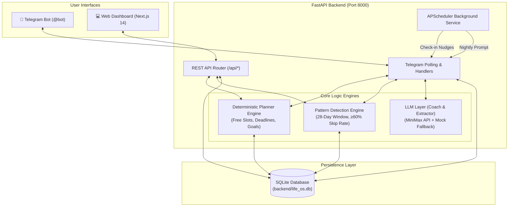
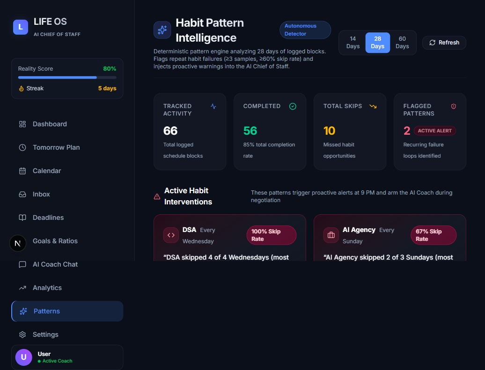
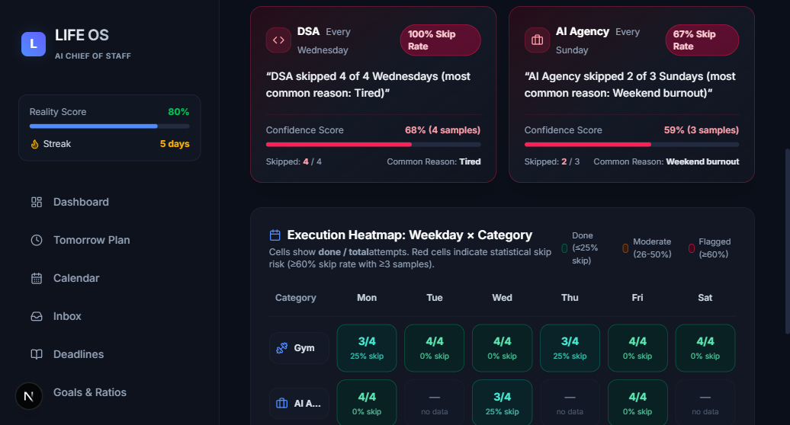
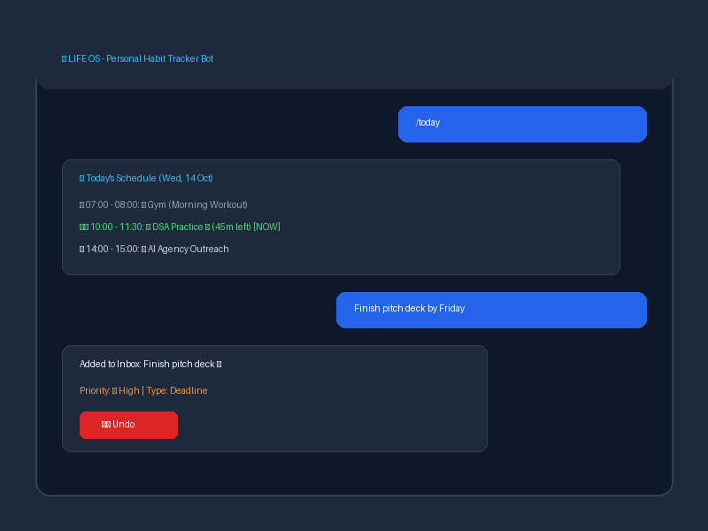

# Life OS: Personal Habit Tracker Agent

> An autonomous AI Chief of Staff and habit intelligence agent that deterministically schedules your day, tracks real-world execution, and detects recurring skip patterns before they derail your goals.

---

## 📌 Problem Statement

People skip habits on certain days and don't notice the pattern. Traditional todo lists and habit trackers are passive graveyards where tasks go to die—they record that you failed, but they never question why or identify when you fail. Without an active accountability partner, students and creators repeatedly abandon critical sessions (such as coding practice or workouts) on specific weekdays due to fatigue, schedule clashes, or poor planning without ever realizing the pattern until weeks of progress are lost.

**Life OS** transforms habit tracking into an active, intelligent feedback loop that spots these failure patterns and proactively intervenes before they repeat.

---

## 🚀 Key Features

- **Done / Skip Logging with Contextual Reasons**: Real-time Telegram check-in prompts log whether each scheduled block was completed or skipped, capturing the exact root cause (`Too tired`, `Unexpected work`, `Bad planning`, `Distraction`, `Low motivation`, `Other`).
- **100% Deterministic Daily Scheduler**: Non-hallucinogenic rule-based planner that locks fixed commitments (college, gym), allocates urgent deadlines with buffer times, and balances remaining hours between long-term goals (AI Agency 60%, DSA 40%).
- **Weekday × Category Pattern Detection**: Offline analytical intelligence analyzing a 28-day rolling window across activity categories (Gym, Agency, DSA, Deadlines) to flag repeat failures with statistical confidence and common reasons.
- **Persistent Long-Term Memory**: Multi-table memory system storing agent traits, detected behavioral patterns (`memory_patterns`), user beliefs (`memory_beliefs`), and conversational states (`chat_state`).
- **Interactive Telegram Bot**: Instant communication hub featuring inline check-in keyboards, schedule approval flows, task inbox capture with one-click **Undo**, and natural language intent routing.
- **Modern Executive Dashboard**: Full-stack Next.js dark-mode interface with an interactive 7-day pattern heatmap, daily schedule timeline, real-time energy gauges, and task management.
- **AI Coach That Challenges Weak Excuses**: Nightly review agent powered by LLM intelligence that reviews tomorrow's plan, spots impending high-risk failure days, challenges weak excuses, and negotiates schedule adjustments.

---

## 🤖 Why It Is an Agent

Life OS is not a passive CRUD app or simple reminder bot. It satisfies the core four-pillar autonomous agent cycle:

```
    ┌────────────────────────┐
    │       1. PERCEIVE      │
    │ Telegram Check-ins,    │
    │ Energy Scores, Tasks   │
    └───────────┬────────────┘
                │
                ▼
    ┌────────────────────────┐
    │       2. REMEMBER      │
    │ SQLite Memory Tables,  │
    │ 28-Day Activity Logs   │
    └───────────┬────────────┘
                │
                ▼
    ┌────────────────────────┐
    │       3. DECIDE        │
    │ Pattern Engine (≥60%), │
    │ Deterministic Planner  │
    └───────────┬────────────┘
                │
                ▼
    ┌────────────────────────┐
    │        4. ACT          │
    │ Schedule Generation,   │
    │ Telegram Nudges, Warns │
    └────────────────────────┘
```

1. **Perceive**: Collects live execution data throughout the day—morning energy ratings (1–5), block completions or skip reasons, and plain-text user inputs routed through intent classification.
2. **Remember**: Stores execution history, behavioral patterns, and user profiles across dedicated tables (`memory_patterns`, `memory_profile`, `daily_schedules`, `schedule_blocks`).
3. **Decide**: Automatically synthesizes historical skip frequencies, identifies upcoming risky days (e.g. Wednesday DSA), and evaluates deterministic constraints to negotiate schedule adjustments.
4. **Act**: Generates daily timetables, dispatches scheduled Telegram notifications, proactively warns about historical pitfalls, and adapts future daily allocations.

---

## 🏗️ Architecture



---

## 🛠️ Tech Stack

| Component | Technology | Description |
|---|---|---|
| **Backend Framework** | FastAPI | High-performance asynchronous REST API |
| **ORM & Database** | SQLAlchemy 2.0 + SQLite | Relational schema with foreign keys and cascade rules |
| **Background Scheduler** | APScheduler | Interval & cron jobs for Telegram notifications |
| **Bot Framework** | python-telegram-bot 21 | Async polling Telegram bot with inline callback keyboards |
| **LLM Intelligence** | MiniMax API (`abab6.5g-chat`) | Night review coach & task extractor with offline mock fallback |
| **Frontend Framework** | Next.js 14 (App Router) | React server & client components with TypeScript |
| **Styling** | Tailwind CSS | Curated dark-mode aesthetic with custom design tokens |
| **State Management** | Zustand | Client-side reactive state management |
| **Visualizations** | Recharts | Interactive weekday × category skip pattern heatmap & graphs |

---

## 📸 Screenshots

The screenshots below are located in [`docs/screenshots/`](docs/screenshots/):

### 1. Executive Dashboard

*Daily schedule timeline with energy gauges, priority breakdown, and task manager.*

### 2. Habit Pattern Intelligence Heatmap

*Weekday × Category matrix displaying skip rates, total sessions, and flagged patterns.*

### 3. Telegram Accountability Bot

*Real-time schedule lookups, current block countdown, and task capture with Undo button.*

---

## 🏁 Getting Started

### Prerequisites
- **Python 3.12+**
- **Node.js 20+** and **npm**
- **Git**

### 1. Clone Repository
```bash
git clone https://github.com/bunnyrams69/Persnol_bot.git
cd Persnol_bot
```

### 2. Backend Setup
```bash
cd backend

# Create and activate virtual environment
python -m venv venv

# Windows PowerShell:
.\venv\Scripts\Activate.ps1
# macOS/Linux:
# source venv/bin/activate

# Install dependencies
pip install -r requirements.txt

# Configure environment variables
cp .env.example .env
# Edit .env with your TELEGRAM_BOT_TOKEN and TELEGRAM_OWNER_ID (optional: MINIMAX_API_KEY)

# Initialize database schema and base seed
python -m app.database.init_db

# Start backend server
python -m uvicorn main:app --port 8000
```
Backend runs on **http://localhost:8000** (Swagger documentation: `http://localhost:8000/docs`).

### 3. Frontend Setup
Open a new terminal:
```bash
cd frontend

# Install Node dependencies
npm install

# Start development server
npm run dev
```
Frontend runs on **http://localhost:3000**.

---

## 🧪 Demo Mode

To see the habit pattern detection and analytics without waiting 28 days:

```bash
# Seed 68 realistic activity blocks across the past 4 weeks
python scripts/seed_demo_data.py

# To reset demo data at any time:
python scripts/seed_demo_data.py --reset
```

Once seeded, open **http://localhost:3000/patterns** in your browser or type `/patterns` in Telegram to view:
- **DSA skipped on Wednesdays** (80% skip rate with reason `Tired`).
- **AI Agency skipped on Fridays** (66% skip rate with reason `Unexpected work`).

---

## 📱 Telegram Commands

| Command | Description |
|---|---|
| `/start` | Initializes your profile, displays app name, and lists commands |
| `/today` | Displays today's schedule, marks active block `▶️`, and shows remaining time `⏳` |
| `/tomorrow` | Reviews tomorrow's planned schedule with proactive pattern alerts and Approve/Negotiate buttons |
| `/energy` | Triggers morning energy check-in (1–5 scale) with focus multipliers |
| `/patterns` | Reports flagged habit skip patterns detected over the last 28 days |
| `/inbox` | Displays the last 5 unprocessed active inbox items with priority symbols |
| `/help` | Shows the full command reference and natural language query tips |

### Natural Language Routing
When idle, the bot intelligently routes plain text:
- *"Hi"* / *"Good morning"* → Friendly greeting + quick command list (saves nothing).
- *"What is the today plan?"* / *"what's next"* → Current schedule from database (saves nothing).
- *"What do I skip?"* → Flagged patterns report (saves nothing).
- *"Finish client logo by Friday"* → Extracts task metadata, adds to Inbox, and attaches an **Undo** button.

---

## 📂 Project Structure

```
Persnol_bot/
├── backend/
│   ├── app/
│   │   ├── analytics/       # Pattern detector (28-day matrix, skip rate threshold) & weekly reviews
│   │   ├── api/             # FastAPI REST endpoints for dashboard, patterns, schedule, inbox
│   │   ├── database/        # SQLite connection, SQLAlchemy models, and init_db script
│   │   ├── llm/             # MiniMax API client, task extractor, and nightly review coach
│   │   ├── planner/         # Deterministic schedule engine, free slots, and goal allocators
│   │   ├── scheduler/       # APScheduler background cron tasks for check-in prompts
│   │   └── telegram/        # Telegram handlers, intent routing, and inline keyboards
│   ├── scripts/             # Demo seeding script with realistic skip distributions
│   ├── tests/               # Pytest suite (pattern engine, scheduler, telegram router)
│   ├── main.py              # Application entry point & lifespan runner
│   ├── requirements.txt     # Python backend dependencies
│   └── .env.example         # Template for environment variables
├── frontend/
│   ├── app/                 # Next.js App Router pages (Dashboard, Tomorrow, Patterns, Inbox)
│   ├── components/          # UI components (Header, Sidebar, Timeline, Matrix Heatmap)
│   ├── lib/                 # API client utilities
│   └── package.json         # Node.js frontend dependencies
├── docs/
│   └── screenshots/         # Dashboard, Heatmap, and Telegram screenshots
├── scripts/
│   └── seed_demo_data.py    # Root delegator script for demo generation
├── .gitignore               # Ignored secrets, databases, and build artifacts
└── README.md                # Project documentation
```

---

## 🔍 How Pattern Detection Works

The pattern detection engine ([`backend/app/analytics/patterns.py`](backend/app/analytics/patterns.py)) runs 100% deterministically without relying on unpredictable LLM outputs:

1. **28-Day Rolling Window**: Filters past logged blocks from the previous 4 weeks (`today - 28 days` to `today - 1 day`).
2. **Category & Weekday Grouping**: Aggregates records into a 7 (Monday–Sunday) × 4 (Gym, Agency, DSA, Deadline) matrix.
3. **Minimum Sample Size**: Requires at least **3 logged occurrences** of a category on that specific weekday to prevent false positives from isolated incidents.
4. **Skip Rate Threshold**: Flags a habit pattern only if:
   $$\text{Skip Rate} = \frac{\text{Skipped Sessions}}{\text{Total Sessions}} \ge 0.60 \quad (60\%)$$
5. **Confidence Scoring**: Confidence scales logarithmically with sample size, bounded between 0.0 and 1.0:
   $$\text{Confidence} = \min\left(1.0, \, 0.5 + 0.1 \times (\text{samples} - 3)\right)$$
6. **Dominant Reason Extraction**: Tallies skip reasons to report the root problem (e.g. *"DSA skipped 4 of 5 Wednesdays (most common reason: Tired)"*).

---

## 🧪 Running Tests

The test suite covers the deterministic scheduler, synthetic pattern edge cases, and the Telegram intent router:

```bash
cd backend
python -m pytest tests/
```

Expected output:
```
tests/test_patterns.py ...                 [ 25%]
tests/test_scheduler.py .                  [ 33%]
tests/test_telegram_router.py ........     [100%]

======================= 12 passed in 2.4s =======================
```

---

## 🔮 Limitations and Future Work

- **Voice Notes Processing**: Transcribing and parsing incoming audio voice notes via Telegram for hands-free task capture.
- **Screen-Time & Activity Integrations**: Ingesting OS-level window focus or browser tracking to automatically confirm or dispute logged block completions.
- **Multi-User Collaboration**: Transitioning from a single-owner chief-of-staff model to multi-tenant teams and family workspaces.

---

## 👥 Team

| Name | Roll No | Role |
|---|---|---|
| **Gunda Ganesh** | *(To be filled)* | Project Lead & Core Architecture |
| **G. Satwik Varma** | 44110105 | Full Stack & Pattern Analytics |
| **G. Venkat Bharadwaj Reddy** | 44110204 | Backend & Scheduler Engine |
| **M. Guhan** | 44110221 | Telegram Bot & Integration Testing |
